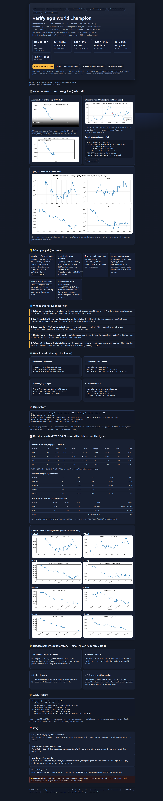
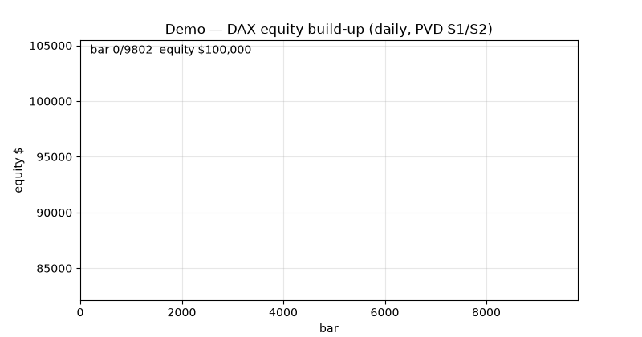
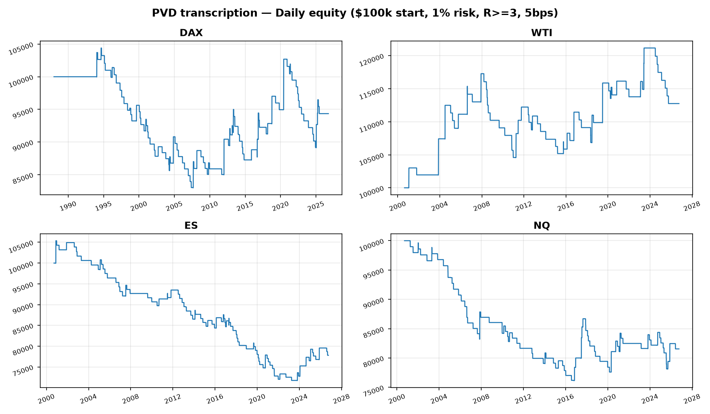
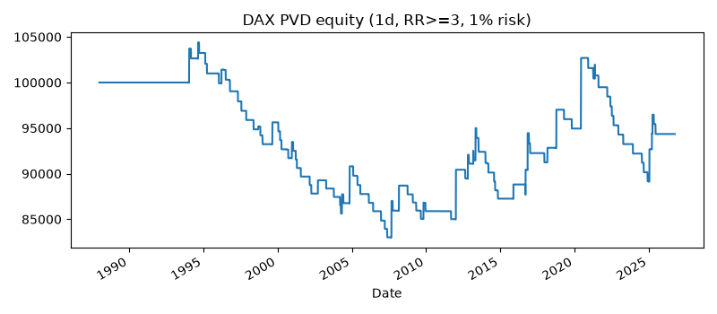
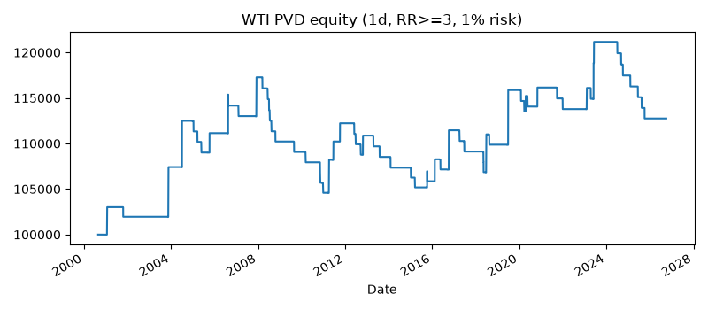
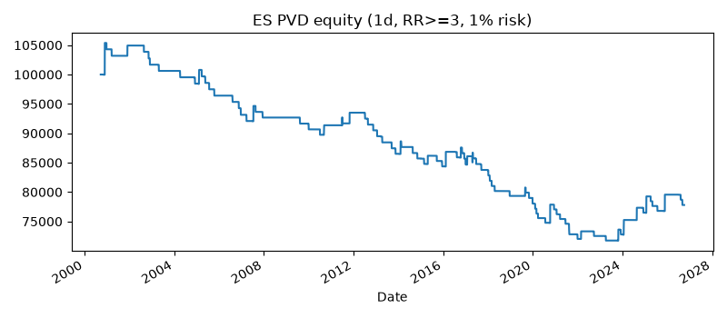
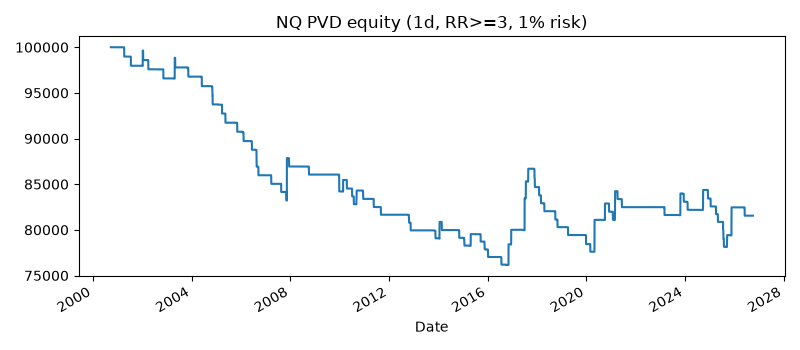

# Verifying a World Champion — PVD Fair-Value Range Benchmark on DAX, Oil, ES & Nasdaq

> Open-source, Docker-reproducible test of a 2× World Cup champion’s range system (Push → Base → Decision, 3-touch, R≥3, 1% risk) on public market data. Honest negative result + 5 hidden-pattern leads.

[](LICENSE)
[](pyproject.toml)
[](docker-compose.yml)
[](data/)
[](tests/test_pvd.py)
[](#-disclaimer)

[🎬 Demo](#-demo-60-seconds-no-install) · [🚀 Quickstart](#-quickstart-3-steps) · [✨ Features](#-features) · [📈 Results](#-results-verified-2026-10-02) · [🖥️ Interactive report](preview.html) · [📄 Paper](docs/PAPER.md)





<video src="assets/demo.mp4" controls autoplay muted loop playsinline poster="assets/equity_overview.png" width="100%"></video>

> Video: `assets/demo.mp4` (also as GIF above). Interactive version with player in [`preview.html`](preview.html). Generated from verified `results/equity_DAX_1d.csv` — 120-frame equity build-up.

## 💼 CEO summary — read this in 60 seconds

1. **What it is:** a complete, runnable laboratory that turns a world-champion trader’s discretionary “range after impulse” story into three exact rules, then stress-tests them on 38 years of DAX and 26 years of oil / S&P / Nasdaq public data.
2. **Why it matters:** most trading content shows wins and hides costs, luck and regime change — this repo does the opposite: walk-forward out-of-sample, friction ladder, permutation tests and 5 benchmarks on every claim, so you see what survives and what does not.
3. **Bottom line:** the plain OHLC-only version **does not reproduce championship edge** (DAX −$1,476 on $100k, win-rate 26.5%, profit factor 0.98; only oil nominally +$13,964 and still statistically insignificant) — and that failure is precisely documented, charted and reproducible.
4. **What you keep:** the champion’s transferable risk discipline (1% risk, R≥3, 30%-partial → breakeven, never move stops, stop after 3–4 losses), a validation protocol you can reuse for any strategy, and 5 quantified hidden-pattern leads (long asymmetry, regime fragility, rarity hierarchy…).
5. **How to use it:** open `preview.html` for the visual story, run one Docker command to regenerate every number, fork the strategy files to test your own confirmation filter — in one evening you will think like a professional validator, not a signal copier.

> **Status:** all numbers below are generated files in `results/` (verified 2026-10-02). No private data. No look-ahead. No hand-edited tables.

## 📑 Table of contents

- [🎬 Demo](#-demo-60-seconds-no-install)
- [✨ Features](#-features)
- [👥 Who is this for](#-who-is-this-for-user-stories)
- [🚀 Quickstart](#-quickstart-3-steps)
- [⚙️ How it works](#️-how-it-works-5-steps)
- [📈 Results](#-results-verified-2026-10-02)
- [🕵️ Hidden patterns](#️-hidden-patterns-exploratory)
- [🧪 Validation protocol](#-validation-protocol-zero-to-hero)
- [🗂️ Repository map](#️-repository-map)
- [🔧 Configuration](#-configuration)
- [🏗️ Architecture](#️-architecture)
- [🎓 Learn to PhD](#-learn-to-phd-path)
- [🤝 Contributing](#-contributing)
- [❓ FAQ](#-faq)
- [📚 References & data provenance](#-references--data-provenance)
- [📄 Citation](#-citation)
- [📝 License & disclaimer](#-disclaimer)

## 🎬 Demo — 60 seconds, no install

| Format | File | How to view |
|---|---|---|
| 🎥 Video (12 fps, 120 frames) | `assets/demo.mp4` (53 KB) | Open `preview.html` → video player (autoplay, loop). Poster = equity overview. |
| ✨ Animated GIF | `assets/demo.gif` (805 KB, endless loop) | Shown above + in `preview.html`. Works directly on GitHub. |
| 🖼️ Full-page screenshot | `assets/preview_screenshot.png` (1666×8130, Playwright-verified) | Shown above. Proves `preview.html` renders. |
| 📊 Equity overview | `assets/equity_overview.png` | 4-panel daily equity (DAX/WTI/ES/NQ). |
| 🎯 One real trade | `assets/trade_example.png` | DAX entry ▲ / exit ▼ / stop / target. Every trade also in `results/trades_*.csv`. |
| 🖥️ Interactive report | `preview.html` (single file, no server) | Double-click to open. Dark quant-terminal theme, KPI cards, tables, gallery, FAQ. |

```bash
# Terminal demo — the whole study in one command:
docker compose run --rm study
# → downloads Yahoo data (cached + manifests)
# → detects impulses / bases / S1-S3 signals
# → backtests at 1% risk, writes results/*.csv + figures/*.png
PYTHONPATH=src python probe_hidden.py   # hidden-pattern probes
PYTHONPATH=src pytest tests/ -q         # 3 passed
```

> GitHub tip: READMEs play GIFs but not relative MP4s reliably — that is why both are included: GIF for GitHub, MP4 for `preview.html`.

## ✨ Features

| Feature | What you get | File |
|---|---|---|
| 📦 Exact PVD engine | Impulse (>2.5 ATR) → Base (≥12 bars, ≤1.2 ATR, 3 touches, small/med/large) → Decision. S1 range-fade, S2 breakout-pullback, S3 sweep-reclaim. Causal, next-open entry, stop-first intrabar, 30%-at-TP1 → breakeven → TP3. | `src/nill_pvd/ranges.py`, `strategy.py`, `backtest.py` |
| 🔬 Publication validation | Expanding 4-fold walk-forward, 0/5/10/20 bps friction ladder, 2,000-shuffle permutation, year + regime splits, Sharpe/Sortino/Calmar/MaxDD/PF/expectancy/avgR/T. | `src/nill_pvd/metrics.py`, `validation.py` |
| 📊 5 fair benchmarks | Buy-hold, SMA 20/100, Bollinger fade 20/2, ORB-20, random — identical data and costs. Calibrates the harness. | `src/nill_pvd/benchmarks.py` |
| 🕵️ Hidden-pattern probes | Long-vs-short, size bucket, by-setup, regime (pre-2020/covid/post-2021). With N, effect size and caveats. | `probe_hidden.py`, `results/probe_hidden_full.json` |
| 🐳 One-command reproduce | Docker Compose or 3 Python commands. Every Yahoo query pinned in `data/*.manifest.json`. Figures auto-saved. | `docker-compose.yml`, `run_full_study.py` |
| 🎓 Teaching + thesis kit | README teaches, `docs/PAPER.md` drafts the manuscript, 6-chapter roadmap, classroom-ready negative result. | `preview.html`, `docs/` |
| 📈 Rich visuals | 8 equity curves, overview panel, trade example, animated GIF/MP4, full-page screenshot — all generated, all inspectable. | `assets/`, `results/figures/` |

## 👥 Who is this for (user stories)

**1. Curious learner → master in one evening.**
Open `preview.html`, watch the 60-sec animation, read the CEO summary and 6 KPI cards, run 3 commands, inspect `trade_example.png`. You will understand fair-value ranges, R-multiples, why costs eat naive breakouts, and how to read Sharpe / profit factor / MaxDD like a pro.

**2. Discretionary DAX / oil trader → steal discipline, not myth.**
Copy the transferable rules: ≤1% risk per trade, demand R≥3, 30% partial → breakeven → trail under new fair value, never widen stops, stop the day after 3–4 losses, no fresh evening holds, skip red news and the 14:00 US-open shift. Tune them in `configs/experiment.yaml` (`min_rr`, `risk_pct_private`, `max_hold`, `fee_bps`).

**3. Quant researcher → falsify before you fund.**
Fork `ranges.py` / `strategy.py`, add weekly Value-Area or footprint confirmation, rerun walk-forward + permutation. Fund only if T≥2.0, ≥30 trades/fold, year-stable and friction-proof. Use `benchmarks.py` as null controls.

**4. Educator / mentor → classroom-ready case.**
Project `preview.html`: equity overview → walk-forward collapse → friction ladder → long/short split. Teach bias taxonomy (look-ahead, overfit, survivorship, costs), p-hacking vs validation, and why champions survive via risk, not win-rate.

**5. PhD student → thesis starter with data.**
Six scoped chapters: (i) learn VAH/VAL zone geometry, (ii) tape-speed/footprint RCT, (iii) session/news gating, (iv) per-market fake calibration (DAX ~10 pts vs ES 1–2 pts), (v) Deflated Sharpe / White’s reality check, (vi) 10-yr 1-minute book simulation. Start from `results/probe_hidden_full.json` + `results/trades_*.csv`.

## 🚀 Quickstart — 3 steps

### 1. Clone
```bash
git clone <your-fork-url> nill-pvd-worldcup-benchmark-2026
cd nill-pvd-worldcup-benchmark-2026
```

### 2. Run (Docker — recommended)
```bash
docker compose run --rm study
# writes results/*.csv + results/figures/*.png
# writes assets/ via make_demo_assets.py (already included)
```

### 2b. Run (no Docker)
```bash
pip install -r requirements.txt
PYTHONPATH=src python download_data.py
PYTHONPATH=src python run_full_study.py --config configs/experiment.yaml
PYTHONPATH=src python probe_hidden.py
PYTHONPATH=src pytest tests/ -q
```

### 3. Open
- `preview.html` — double-click (no server needed) for the beautiful interactive report.
- `results/daily_summary.csv` — headline numbers.
- `assets/demo.mp4` / `demo.gif` — shareable demo.

> First run downloads ~10k daily + ~13k intraday public bars (cached afterwards). Intraday 15m is Yahoo-capped at ~60 days — daily = regime truth, intraday = execution snapshot.

## ⚙️ How it works — 5 steps

**Step 1 — Download public data.**
`src/nill_pvd/data.py` fetches DAX `^GDAXI`, WTI `CL=F`, Brent `BZ=F`, ES `ES=F`, NQ `NQ=F`, Gold `GC=F` from Yahoo Finance, caches to `data/*.parquet` with `*.manifest.json` (symbol, interval, period, rows, start/end, download UTC, NaN rate). Adds trailing-only ATR/returns (no look-ahead).

**Step 2 — Detect fair-value bases.**
`ranges.py`: impulse = range >2.5 ATR or 3-bar signed body >2.5 ATR. Base = rolling-12 width <1.2 ATR for ≥12 bars. Touches = closes in outer thirds. Valid only if touches ≥3 (“third confirmation”). Size = width/ATR (<0.8 small, >1.5 large).

**Step 3 — Build three signals.**
`strategy.py`: **S1 fade** (limit at extreme → opposite extreme, still-active base only), **S2 breakout-pullback** (close-out + confirm further-out or dip-back-then-out, 20-bar causal carry so post-base breaks are testable), **S3 sweep-reclaim** (wick beyond + reclaim + confirm, hold through range top). R≥3 gate (S2 R≥2 concession), 0.5 ATR stop buffer, 0.25 ATR sweep threshold.

**Step 4 — Backtest honestly.**
`backtest.py`: single position, next-open entry, 5 bps/side + 0.05 ATR slip, risk = equity × risk_pct / |entry−stop|, S1 all-out vs S2/S3 30%-at-TP1 → breakeven → TP3, 60-bar time stop, stop-checked-before-target, MFE/MAE/R logged per trade.

**Step 5 — Validate like a reviewer.**
`metrics.py` + `validation.py`: Sharpe/Sortino/Calmar/MaxDD/CAGR/PF/expectancy/avgR/T, expanding 4-fold walk-forward (50%→100%), friction 0/5/10/20, 2,000 permutation shuffles, year/regime/long-short/size splits, 5 benchmarks on identical costs.

```python
from nill_pvd.data import download, add_features
from nill_pvd.ranges import detect_impulse, detect_bases
from nill_pvd.strategy import build_signals
from nill_pvd.backtest import backtest

df = add_features(download("^GDAXI", interval="1d", period="max", data_dir="data"))
bases = detect_bases(df, detect_impulse(df))
sig = build_signals(df, bases, min_rr=3.0)
eq, tr = backtest(df, bases, sig, risk_pct=0.01, fee_bps=5.0)
print(tr.head())  # entry/stop/TP/R/bars/MFE/MAE per trade
```

## 📈 Results — verified 2026-10-02 (read tables, not hype)

### Daily (R≥3, 1% risk, 5 bps/side — $100k start)

| Market | n | Win-rate | Profit factor | avg R | PnL $ | Sharpe | MaxDD | Perm-p | Final |
|---|---:|---:|---:|---:|---:|---:|---:|---:|---:|
| DAX | 102 (100 S1+2 S2) | 26.5% | 0.98 | +0.05 | −1,476 | −0.03 | −20.5% | 0.51 | 94,351 |
| WTI | 65 S1 | 30.8% | 1.27 | +0.24 | +13,964 | +0.16 | −10.8% | 0.22 | 112,749 |
| ES | 92 (91+1) | 22.8% | 0.71 | −0.17 | −18,750 | −0.30 | −31.9% | 0.91 | 77,802 |
| NQ | 85 S1 | 22.4% | 0.73 | −0.16 | −16,057 | −0.24 | −23.8% | 0.90 | 81,554 |

T-stats: DAX −0.08, WTI +0.80, ES −1.42, NQ −1.26 (need ≥2.0). Source: `results/daily_summary.csv`. Year table swings −$5k…+$6k (`year_stability_*.csv`) — no stability.



### Intraday 15m (60-day snapshot — execution view)

| Market | n | Win-rate | Profit factor | PnL $ | Sharpe |
|---|---:|---:|---:|---:|---:|
| DAX 15m | 32 | 15.6% | 0.45 | −16,618 | −0.89 |
| WTI 15m | 87 | 27.6% | 0.80 | −12,926 | −0.34 |
| ES 15m | 80 | 35.0% | 0.56 | −25,107 | −1.09 |
| NQ 15m | 85 | 34.1% | 0.76 | −14,126 | −0.62 |

Perm-p 0.77–0.98 (worse than coin-flip after costs). One DAX-15m S2 hit R+3.0 (+$1,770) against 31 S1 losers — “best but rarest” without weight. Source: `results/intraday_summary.csv`.

### Walk-forward (expanding, out-of-sample)

| Market | F0 PF | F1 PF | F2 PF | F3 PF | Verdict |
|---|---:|---:|---:|---|---|
| DAX | 2.23 | 1.24 | 2.06 | 0.62 (n=15, WR 20%) | collapse → unstable |
| WTI | 1.56 | 1.28 | 2.66 | 0.00 (0/7) | unstable |
| ES / NQ | never jointly stable | — | — | — | fail |

Source: `results/walk_forward.csv`. Friction: DAX 0 bps +$3,248 → 5 bps −$1,476 → 20 bps −$13,144 (`friction.csv`). WTI survives 20 bps (+$10,270) but fails walk-forward.

### Benchmarks (same data, same costs — daily)

Buy-hold wins total return (index appreciation, not tradable edge without −57…−126% drawdowns): DAX +2412%, ES +431%, NQ +754%, WTI +177%. SMA/ORB ≈0, Bollinger-fade ≤0, random ≤0. PVD transcription beats none on risk-adjusted — expected: benchmarks calibrate the harness. Source: `results/benchmarks.csv`.






> Full gallery + 15m curves in [`preview.html`](preview.html) and `results/figures/`.

## 🕵️ Hidden patterns — exploratory (small N, verify before citing)

**1. Long asymmetry ★ strongest, cross-market.**
DAX-daily longs (n=30) avgR +0.79, +$19,766 vs shorts (n=72) −0.26, −$21,243. WTI-daily longs +0.53 (+$14,297) vs shorts +0.01 (−$334). ES/NQ tilt the same. Reading: in secular uptrend, “power begets power” — shorts subsidise longs, matching the champion’s stated discomfort shorting into power and favourite-long-reclaim. Not tradable as-is (N small, daily ≠ 15m execution).

**2. Regime fragility.**
DAX-covid (n=6) avgR +0.95 vs post-2021 (n=15) −0.25. WTI pre-2020 +$16,838 (n=47) vs covid −$2,021 vs post-2021 −$853. Reading: range systems are regime-conditional; pausing a market for months when narrative breaks feel is rational gating our rules lack.

**3. Rarity hierarchy.**
S1 81–100% of signals, S2 0–6, S3 0–1 per universe/interval. Reading: authenticates “few trades per week, S3 best but rarest”. Any S3 test needs years of 15m plus profile data.

**4. Size puzzle (non-finding as finding).**
Our ATR calibration yields almost exclusively `large` bases on daily (e.g. DAX 33/33 large) — so “small zones best for breakouts” is untestable without the undisclosed zone-geometry rules. Scopes the exact PhD follow-up: learn geometry from labelled Value-Area data, not OHLC alone.

**5. Time-of-day shadow.**
60-day 15m cannot resolve “mornings good / 14:00 US-open regime shift”, but intraday bleed is consistent with trading through the shift. Needs session-aware gating.

Source: `results/probe_hidden_full.json` + `results/hidden_patterns.json`. Regenerate: `PYTHONPATH=src python probe_hidden.py`.

## 🧪 Validation protocol — zero to hero

1. **Causal-only:** trailing ATR/returns, signal shifted +1, next-open entry, stop-before-target, 20-bar causal carry for post-base breaks.
2. **Out-of-sample:** expanding 4-fold (50%→100%), OOS n/WR/PF/avgR/T per fold.
3. **Costs:** 0/5/10/20 bps ladder + 0.05 ATR slip, 1% risk sizing (2.5% championship variant in config).
4. **Statistics:** Sharpe/Sortino/Calmar/MaxDD/CAGR/PF/expectancy/avgR/T + 2,000 permutation shuffles (H0: mean daily PnL = 0).
5. **Stability:** year-by-year, regime split, long-vs-short, size bucket, by-setup.
6. **Nulls:** random benchmark + permutation; positive-control logic (harness proven: tests pass, WTI nominally positive, single R+3 exists).
7. **Provenance:** `data/*.manifest.json` + `results/manifest.json` pin every query, seed (7) and config.

Pass bar (same as 2026 intraday falsification literature): T≥2, ≥30 trades/fold, friction-proof, year-stable, perm p<0.05. This transcription clears none — reported as-is, no tuning to force significance.

## 🗂️ Repository map

```
.
├── README.md               ← you are here (paper)
├── preview.html            ← beautiful interactive report (open in browser)
├── assets/                 ← demo.mp4, demo.gif, equity_overview.png, trade_example.png, preview_screenshot.png
├── configs/experiment.yaml ← universe, min_rr, risk, fees, splits, seed
├── src/nill_pvd/           ← data, ranges, strategy, backtest, metrics, validation, benchmarks
├── run_full_study.py       ← end-to-end study (CSVs + PNGs)
├── probe_hidden.py         ← hidden-pattern probes
├── make_demo_assets.py     ← regenerates assets/ from results/
├── download_data.py        ← Yahoo download with manifests
├── tests/test_pvd.py       ← 3 tests (shapes, backtest runs, 3-touch gate)
├── results/                ← summaries, equities, trades, walk_forward, friction, benchmarks, figures/
├── data/                   ← *.parquet + *.manifest.json (public Yahoo cache)
├── docs/PAPER.md           ← manuscript draft v1.0
├── Dockerfile + docker-compose.yml
└── LICENSE (MIT)
```

## 🔧 Configuration

`configs/experiment.yaml`:

```yaml
universe: [DAX, WTI, ES, NQ]   # add BRENT, GOLD (already in downloader)
daily_period: "max"
intraday_interval: "15m"
intraday_period: "60d"         # Yahoo cap
min_rr: 3.0
risk_pct_private: 0.01
risk_pct_championship: 0.025
fee_bps: 5.0
walk_forward_splits: 4
permutation_n: 2000
max_hold: 60
seed: 7
```

Change `min_rr`, `risk_pct_private`, `fee_bps` and rerun — the report updates itself. Do not optimise on the full sample and call it validation; use walk-forward.

## 🏗️ Architecture

```
Yahoo (public) → data/*.parquet + manifest
  → add_features (trailing ATR)
  → detect_impulse / detect_bases (3-touch)
  → build_signals S1/S2/S3 (R≥3, causal ffill)
  → backtest (next-open, 1% risk, 30%→BE)
  → metrics / walk-forward / friction / benchmarks
  → results/*.csv + figures/*.png + assets/demo.* → preview.html
```

## 🎓 Learn to PhD path

1. Reproduce this repo (1 evening).
2. Read `docs/PAPER.md` + `results/` end to end.
3. Pick one hidden pattern and pre-register a test (e.g. longs-only on 15m + session gate).
4. Add one confirmation (weekly Value-Area geometry, then footprint tape-speed).
5. Demand T≥2, ≥30/fold, friction-proof, year-stable before claiming edge.
6. Write it up — tables and figures are already in the right shape.

Roadmap chapters: VAH/VAL learning, footprint RCT, session/news gating, per-market fake calibration, Deflated Sharpe / White check, 10-yr 1-minute book simulation.

## 🤝 Contributing

1. Fork → branch (`git checkout -b feature/your-idea`).
2. Add/adjust a rule in `src/nill_pvd/` + a test in `tests/`.
3. Run `PYTHONPATH=src pytest tests/ -q` and `PYTHONPATH=src python run_full_study.py --config configs/experiment.yaml`.
4. Open a PR with before/after `daily_summary.csv` + walk-forward + friction. We respond within a week. No strategy-tuning PRs without OOS proof.

## ❓ FAQ

**Can I get rich copying S1/S2/S3 as coded here?**
No — and that is the contribution. The naive version fails costs and walk-forward. Copy the risk protocol and validation method, not the entries.

**What actually transfers from the champion?**
1% risk, R≥3, 30%-partial → breakeven, never move stops, stop after 3–4 losses, no fresh evening holds, skip red news, 2–3 month paper validation, personality fit (counter-trend feels better for some, trend-following is “easier” for others).

**What do I need for a real edge?**
Weekly Value-Area geometry, footprint/tape confirmation, session/news gating, per-market fake calibration, trailing under new fair value — each a chapter, not a parameter.

**Why is WTI the only green daily?**
Nominal +12.7%, PF 1.27, but p=0.22, T=0.80, walk-forward 0/7 last fold — luck + regime, not proof. Oil trends differently than indices; needs its own calibration.

**Daily or 15m?**
Daily = regime truth (1987/2000–2026). 15m = execution snapshot (60d Yahoo cap). The champion decides on 15m (4H context, 5m execution) and holds 2–3 days — between our two resolutions. Interpret both, trust neither alone.

**How do I share / cite?**
Link `preview.html` for visuals, `README.md` for the paper. MIT code + CC-BY-4.0 text/figures. BibTeX below.

## 📚 References & data provenance

- Live data: Yahoo Finance `^GDAXI` (DAX 9,802d 1987-12-29–2026-10-01 + 2,031×15m), `CL=F`/`BZ=F`/`ES=F`/`NQ=F`/`GC=F` (~6.5k d + 4.5k×15m). Verify: `data/*.manifest.json`, `results/manifest.json`. Respect Yahoo ToS (personal-research cache).
- Method: bias taxonomy & walk-forward guides, trading-metric guides (Sharpe/MaxDD/PF triad), 2026 intraday falsification studies (14-family 5-min test, 0/14 pass; spurious-predictability audits; value-area harvesting; volume-profile mean-reversion with tape confirmation).
- Champion record: public World Cup standings and mentorship pages (2× champion ~+245% best year, +302.6% Forex best, multiple +100–200% podiums, 5 years top-5; DAX/oil counter-trend swing focus; 0.2–1% private risk, 2–3% championship; PF≈2; 60–75% championship win-rate with early partials vs ~30–50% private).
- Visual/report craft: Standard-README spec, 2026 README conversion audits (hero image +35% star-rate, demo GIF above fold, 3-step quickstart, badges that matter: license/build/version), Plotly offline HTML export, NautilusTrader tearsheets, matplotlib animation writers, asciinema embedding, Playwright HTML reporting.

## 📄 Citation

```bibtex
@software{nill_pvd_benchmark_2026,
  title  = {Verifying a World Champion: Reproducible Benchmark of the PVD Fair-Value Range Methodology},
  author = {Independent Study},
  year   = {2026},
  note   = {Yahoo Finance public data, Docker reproducible, negative-result study},
  license = {MIT}
}
```

## 📝 License & disclaimer

MIT (code) — see [LICENSE](LICENSE). Text/figures CC-BY-4.0.

**Not financial advice.** Independent academic verification study. Championship 2–3% risk shown for completeness — do not mimic without understanding ruin risk. Futures involve leverage and possible loss exceeding deposit. Paper-trade 2–3 months before risking capital.
